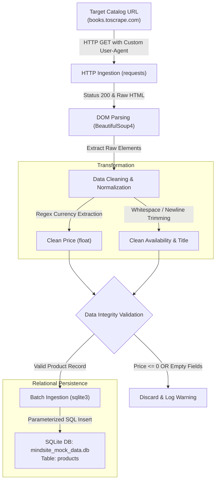

# 🛒 E-Commerce Web Scraping & Data Processing Pipeline

[](https://www.python.org/)
[](https://www.sqlite.org/)
[](https://pypi.org/project/beautifulsoup4/)
[](LICENSE)

An end-to-end automated ETL (Extract, Transform, Load) data pipeline developed for e-commerce catalog monitoring and analytics. Built to showcase core software engineering best practices for an e-commerce intelligence platform, emphasizing **automated data extraction**, **data cleaning**, and **ensuring data integrity via SQL**.

---

## 📌 Project Overview

In the e-commerce analytics industry, collecting reliable, timely, and structurally validated product data is critical for competitive pricing analysis, stock tracking, and market intelligence.

This project implements an automated pipeline that targets e-commerce category feeds (using [Books to Scrape](http://books.toscrape.com/catalogue/category/books/science_22/index.html) as a live testing ground), extracts raw product elements, normalizes pricing and availability metrics, validates records against business logic, and persists them into a local relational database (`mindsite_mock_data.db`).

### Key Highlights
- **Automated Data Extraction**: Handles HTTP sessions with custom headers and resilient error management.
- **Data Cleaning & Normalization**: Strips currency noise, converts price data into standard float representations, and normalizes unstructured text.
- **Multi-Tier Data Integrity**: Enforces strict validation both at the application runtime level and within the database schema using SQL `CHECK` constraints and parameterized queries.

---

## 🏗️ Architecture & Pipeline Flow

The pipeline executes a deterministic, multi-stage ETL workflow:



---

## 🚀 Key Features

### 1. Robust Web Crawling & Scraping
- **Request Configuration**: Uses realistic browser headers (`User-Agent`) and connection timeouts to ensure reliable web requests.
- **Targeted DOM Parsing**: Utilizes `BeautifulSoup4` with CSS selectors to pinpoint `article.product_pod` containers, accurately grabbing full book titles from anchor `title` attributes even when displayed text is truncated.

### 2. Data Cleaning & Transformation
- **Currency Sanitization**: Extracts numerical amounts using regular expressions (`re.search(r"(\d+(?:\.\d+)?)", ...)`), seamlessly eliminating currency symbols (`£`, `$`, `€`) and casting values directly to floating-point numbers.
- **String Sanitation**: Strips leading/trailing whitespaces, newline characters (`\n`), and redundant tab stops across product titles and stock availability flags.

### 3. SQL Validation & Data Integrity
- **Multi-Level Validation**:
  - **Application-Layer**: Validates that product prices are strictly positive (`price > 0`) and mandatory fields (`title`, `availability`) are non-empty prior to database execution.
  - **Database-Layer**: Enforces SQL schema constraints (`CHECK (price > 0)`, `CHECK (length(availability) > 0)`).
- **SQL Injection Prevention**: Employs parameterized queries (`?`, `?`, `?`, `?`) via Python's standard `sqlite3` module.
- **Audit Logging**: Stamps each inserted record with an ISO-8601 UTC timestamp (`scraped_at`).

---

## 🗄️ Database Schema

The pipeline automatically provisions a local SQLite database named `mindsite_mock_data.db` with the following `products` table schema:

| Column Name | Data Type | Constraints | Description |
| :--- | :--- | :--- | :--- |
| `id` | `INTEGER` | `PRIMARY KEY AUTOINCREMENT` | Unique identifier for each record. |
| `title` | `TEXT` | `NOT NULL` | Cleaned full title of the product. |
| `price` | `REAL` | `NOT NULL, CHECK (price > 0)` | Cleaned price stored as a numerical float. |
| `availability`| `TEXT` | `NOT NULL, CHECK (length > 0)`| Stock availability state (e.g., `'In stock'`). |
| `scraped_at` | `TIMESTAMP`| `NOT NULL` | UTC timestamp recording when extraction occurred. |

### DDL Definition
```sql
CREATE TABLE IF NOT EXISTS products (
    id INTEGER PRIMARY KEY AUTOINCREMENT,
    title TEXT NOT NULL,
    price REAL NOT NULL,
    availability TEXT NOT NULL,
    scraped_at TIMESTAMP NOT NULL,
    CONSTRAINT chk_price CHECK (price > 0),
    CONSTRAINT chk_availability CHECK (length(availability) > 0)
);
```

---

## 🛠️ Tech Stack

- **Language**: Python 3.10+
- **HTTP Client**: [`requests`](https://requests.readthedocs.io/)
- **HTML Parser**: [`beautifulsoup4`](https://www.crummy.com/software/BeautifulSoup/)
- **Database Engine**: [`sqlite3`](https://docs.python.org/3/library/sqlite3.html) (Built-in)
- **Data Sanitization**: Regular Expressions (`re`)

---

## 📂 Project Structure

```text
E-Commerce-Scraper-Pipeline/
│
├── scraper.py                 # Core scraping, transformation, and DB ingestion pipeline
├── requirements.txt           # Project dependencies (requests, beautifulsoup4)
├── .gitignore                 # Standard Python/IDE/DB ignore rules
└── README.md                  # Comprehensive portfolio documentation
```

---

## ⚙️ How to Run

### 1. Prerequisites
- Python 3.8 or higher installed on your system.
- Git installed.

### 2. Clone the Repository
```bash
git clone https://github.com/Erlik-1417/E-Commerce-Scraper-Pipeline.git
cd E-Commerce-Scraper-Pipeline
```

### 3. Create and Activate a Virtual Environment
```bash
# On macOS / Linux:
python3 -m venv .venv
source .venv/bin/activate

# On Windows (PowerShell):
python -m venv .venv
.venv\Scripts\Activate.ps1
```

### 4. Install Dependencies
```bash
pip install -r requirements.txt
```

### 5. Execute the Pipeline
Run the scraper script:
```bash
python scraper.py
```

### 6. Terminal Output Example
```text
=================================================================
  E-COMMERCE DATA EXTRACTION & INGESTION PIPELINE
=================================================================
Target URL : http://books.toscrape.com/catalogue/category/books/science_22/index.html
Database   : mindsite_mock_data.db
-----------------------------------------------------------------
[2026-11-09 19:44:06] [INFO] Initializing database at: mindsite_mock_data.db
[2026-11-09 19:44:06] [INFO] Database schema verified (table 'products' is ready).
[2026-11-09 19:44:06] [INFO] Fetching target URL: http://books.toscrape.com/catalogue/category/books/science_22/index.html
[2026-11-09 19:44:06] [INFO] Discovered 14 product cards in HTML.
-----------------------------------------------------------------
[SUMMARY] Found: 14 | Valid & Inserted: 14
Successfully scraped and saved 14 products.
=================================================================
```

### 7. Inspecting the Extracted Data
You can query the SQLite database directly using Python:
```bash
python -c "import sqlite3; conn = sqlite3.connect('mindsite_mock_data.db'); print(conn.cursor().execute('SELECT id, title, price, availability, scraped_at FROM products LIMIT 5').fetchall())"
```

---

## 🔮 Scalability & Future Enhancements

Designed with modularity in mind, this architecture can readily expand into an enterprise-scale distributed crawler:
- **Pagination & Deep Crawling**: Crawl multi-page categories and product detail pages concurrently.
- **Asynchronous IO**: Migrate from synchronous `requests` to `aiohttp` or `playwright` for dynamic JavaScript rendering.
- **Proxy & IP Rotation**: Integrate rotating residential proxies and request throttling to avoid rate limiting.
- **Automated Scheduling**: Deploy as a containerized job on Docker or Kubernetes, orchestrated via Apache Airflow or GitHub Actions.

---

## 👤 Author

Developed by **Erlik-1417**  
GitHub: [@Erlik-1417](https://github.com/Erlik-1417)
