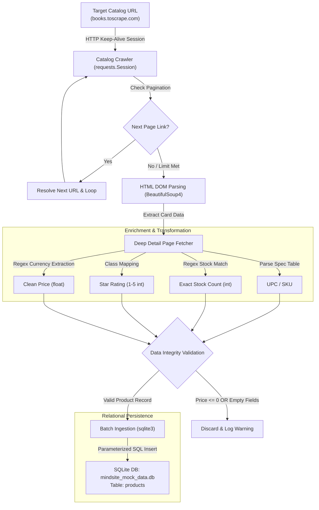

# 🛒 E-Commerce Web Scraping & Data Processing Pipeline

[](https://www.python.org/)
[](https://www.sqlite.org/)
[](https://pypi.org/project/beautifulsoup4/)
[](LICENSE)

An end-to-end automated ETL (Extract, Transform, Load) data pipeline developed for e-commerce catalog monitoring and analytics. Built to showcase core software engineering best practices for an e-commerce intelligence platform, emphasizing **automated data extraction**, **data cleaning**, and **ensuring data integrity via SQL**.

---

## 📌 Project Overview

In the e-commerce analytics industry, collecting reliable, timely, and structurally validated product data is critical for competitive pricing analysis, stock tracking, and market intelligence.

This project implements an automated pipeline that targets e-commerce category feeds (using [Books to Scrape](http://books.toscrape.com/catalogue/category/books/science_22/index.html) as a live testing ground), extracts raw product elements, normalizes pricing and availability metrics, validates records against business logic, and persists them into a local relational database (`mindsite_mock_data.db`).

### Key Highlights
- **Automated Pagination Crawler**: Seamlessly detects and traverses multi-page categories until all catalog records are extracted.
- **Deep Data Enrichment**: Crawls individual product detail pages to extract high-value e-commerce metrics (**UPC / SKU**, **exact stock numbers**, **star ratings**, and **direct product URLs**).
- **HTTP Connection Pooling**: Employs `requests.Session` with HTTP Keep-Alive for high-throughput network operations.
- **Data Cleaning & Normalization**: Strips currency noise, converts price data into standard float representations, and normalizes unstructured text.
- **Multi-Tier Data Integrity & Migration**: Enforces strict validation at runtime and within the database schema using SQL `CHECK` constraints, parameterized queries, and safe schema migration.

---

## 🏗️ Architecture & Pipeline Flow

The pipeline executes a deterministic, multi-stage ETL workflow:



---

## 🚀 Key Features

### 1. Robust Web Crawling & Automated Pagination
- **Multi-Page Traversal**: Intelligently identifies `<li class="next"><a href="...">` pagination tags, resolves relative links, and navigates across catalog pages until the category is completely crawled.
- **Configurable Crawl Limits**: Accepts `--max-pages` to restrict depth for testing or quick audits.
- **Optimized HTTP Session**: Reuses underlying TCP connections via `requests.Session` to avoid TLS handshakes for every detail page request.

### 2. Deep Data Enrichment (Detail Scraping)
Going beyond basic catalog cards, the pipeline performs deep inspection on product detail pages to capture high-value e-commerce fields:
- **UPC / SKU**: Extracts unique hardware/product identification codes from the product specifications table.
- **Stock Availability Count**: Uses regex (`\((\d+)\s+available\)`) to parse exact stock quantities into integers (e.g., `16`) rather than just raw status strings.
- **Star Rating (1–5)**: Maps textual CSS classes (`One`, `Two`, `Three`, `Four`, `Five`) into normalized integer ratings.
- **Product Canonical URL**: Stores the direct, absolute link to the product for downstream auditing.

### 3. Data Cleaning & Transformation
- **Currency Sanitization**: Extracts numerical amounts using regular expressions (`re.search(r"(\d+(?:\.\d+)?)", ...)`), eliminating currency noise (`£`, `$`, `€`) and casting directly to `float`.
- **String Sanitation**: Strips leading/trailing whitespaces, newline characters (`\n`), and redundant tab stops across product titles and stock availability flags.

### 4. SQL Validation & Data Integrity
- **Multi-Level Validation**:
  - **Application-Layer**: Validates that product prices are strictly positive (`price > 0`), ratings are bounded `[1, 5]`, stock count is non-negative (`>= 0`), and mandatory fields (`title`, `availability`) are non-empty prior to database execution.
  - **Database-Layer**: Enforces SQL schema constraints (`CHECK (price > 0)`, `CHECK (length(availability) > 0)`).
- **Automated Schema Migration**: On initialization, inspects existing tables via SQLite `PRAGMA table_info` and safely performs non-destructive schema migrations (`ALTER TABLE`) if new enrichment columns are introduced.
- **SQL Injection Prevention**: Employs parameterized queries (`?`, `?`, `?`, ...) via Python's standard `sqlite3` module.
- **Audit Logging**: Stamps each inserted record with an ISO-8601 UTC timestamp (`scraped_at`).

---

## 🗄️ Database Schema

The pipeline provisions a local SQLite database named `mindsite_mock_data.db` with the following enriched `products` table schema:

| Column Name | Data Type | Constraints | Description |
| :--- | :--- | :--- | :--- |
| `id` | `INTEGER` | `PRIMARY KEY AUTOINCREMENT` | Unique identifier for each record. |
| `upc` | `TEXT` | `NULLABLE` | Unique product identifier / barcode. |
| `title` | `TEXT` | `NOT NULL` | Cleaned full title of the product. |
| `price` | `REAL` | `NOT NULL, CHECK (price > 0)` | Cleaned price stored as a numerical float. |
| `stock_count` | `INTEGER` | `NULLABLE, CHECK (stock_count >= 0)` | Exact units currently in stock. |
| `availability`| `TEXT` | `NOT NULL, CHECK (length > 0)`| Stock availability state (e.g., `'In stock'`). |
| `rating` | `INTEGER` | `NULLABLE, CHECK (rating BETWEEN 1 AND 5)` | Normalized review score (1 to 5). |
| `product_url` | `TEXT` | `NULLABLE` | Canonical URL pointing to the product page. |
| `scraped_at` | `TIMESTAMP`| `NOT NULL` | UTC timestamp recording when extraction occurred. |

### DDL Definition
```sql
CREATE TABLE IF NOT EXISTS products (
    id INTEGER PRIMARY KEY AUTOINCREMENT,
    upc TEXT,
    title TEXT NOT NULL,
    price REAL NOT NULL,
    stock_count INTEGER,
    availability TEXT NOT NULL,
    rating INTEGER,
    product_url TEXT,
    scraped_at TIMESTAMP NOT NULL,
    CONSTRAINT chk_price CHECK (price > 0),
    CONSTRAINT chk_availability CHECK (length(availability) > 0)
);
```

---

## 🛠️ Tech Stack

- **Language**: Python 3.10+
- **HTTP Client**: [`requests`](https://requests.readthedocs.io/) (Session Connection Pooling)
- **HTML Parser**: [`beautifulsoup4`](https://www.crummy.com/software/BeautifulSoup/)
- **Database Engine**: [`sqlite3`](https://docs.python.org/3/library/sqlite3.html) (Built-in)
- **URL Handling**: `urllib.parse`
- **CLI Parsing**: `argparse`

---

## 📂 Project Structure

```text
E-Commerce-Scraper-Pipeline/
│
├── scraper.py                 # Core scraping, transformation, and DB ingestion pipeline
├── requirements.txt           # Project dependencies (requests, beautifulsoup4)
├── .gitignore                 # Standard Python/IDE/DB ignore rules
└── README.md                  # Comprehensive portfolio documentation
```

---

## ⚙️ How to Run

### 1. Prerequisites
- Python 3.8 or higher installed on your system.
- Git installed.

### 2. Clone the Repository
```bash
git clone https://github.com/Erlik-1417/E-Commerce-Scraper-Pipeline.git
cd E-Commerce-Scraper-Pipeline
```

### 3. Create and Activate a Virtual Environment
```bash
# On macOS / Linux:
python3 -m venv .venv
source .venv/bin/activate

# On Windows (PowerShell):
python -m venv .venv
.venv\Scripts\Activate.ps1
```

### 4. Install Dependencies
```bash
pip install -r requirements.txt
```

### 5. Execute the Pipeline
Run the default scraper (Science category, full deep enrichment):
```bash
python scraper.py
```

#### CLI Options
```bash
# Scrape with page limit:
python scraper.py --max-pages 2

# Scrape another category:
python scraper.py --url "http://books.toscrape.com/catalogue/category/books/travel_2/index.html"

# Run fast crawl without detail page scraping:
python scraper.py --no-deep-scrape
```

### 6. Terminal Output Example
```text
====================================================================
  E-COMMERCE DATA EXTRACTION & INGESTION PIPELINE (v1.1)
====================================================================
Target URL   : http://books.toscrape.com/catalogue/category/books/science_22/index.html
Database     : mindsite_mock_data.db
Deep Scrape  : Enabled (UPC, Stock, Rating, URL)
Max Pages    : All Available
--------------------------------------------------------------------
[2026-11-09 19:58:34] [INFO] Initializing database at: mindsite_mock_data.db
[2026-11-09 19:58:34] [INFO] Database schema verified (table 'products' is ready and up to date).
[2026-11-09 19:58:34] [INFO] Crawling Page #1: http://books.toscrape.com/catalogue/category/books/science_22/index.html
[2026-11-09 19:58:35] [INFO] Discovered 14 products on page: http://books.toscrape.com/catalogue/category/books/science_22/index.html
[2026-11-09 19:58:37] [INFO] No further pagination detected. Category crawl complete.
[2026-11-09 19:58:37] [INFO] Crawl completed across 1 page(s). Total products extracted: 14
--------------------------------------------------------------------
[SUMMARY] Total Extracted: 14 | Valid & Inserted: 14
Successfully scraped and saved 14 products.
====================================================================
```

### 7. Inspecting the Extracted Data
Query enriched records using Python:
```bash
python -c "import sqlite3; conn = sqlite3.connect('mindsite_mock_data.db'); print(conn.cursor().execute('SELECT upc, title, price, stock_count, rating FROM products LIMIT 3').fetchall())"
```

---

## 🔮 Scalability & Future Roadmap

- [x] Automated Pagination Handling
- [x] Deep Product Detail Enrichment (UPC, Stock Count, Star Rating, Canonical URL)
- [ ] Price History Tracking & Anomaly Alerts (Slowly Changing Dimensions)
- [ ] Asynchronous Crawling (`aiohttp` / `asyncio`)
- [ ] Automated Test Suite (`pytest` with mock fixtures)
- [ ] Continuous Integration & Scheduled Crawl via GitHub Actions

---

## 👤 Author

Developed by **Erlik-1417**  
GitHub: [@Erlik-1417](https://github.com/Erlik-1417)
